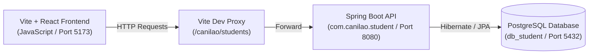

# Project Context & Continuation Guide: Student CRUD Application

This document preserves the complete architectural context, API contract, technology choices, and step-by-step roadmap for developing the Vite + React (JavaScript) frontend for the Student CRUD API.

---

## 1. System Architecture Overview



---

## 2. Backend Analysis (Existing Spring Boot Service)

- **Source Location**: `./student`
- **Framework**: Spring Boot 3.x (Java 21, Maven)
- **Database**: PostgreSQL (`jdbc:postgresql://localhost:5432/db_student`, user: `postgres`)
- **Base URI**: `/canilao/students`
- **Controller**: `StudentController.java` (`@Controller`, `@RequestMapping(path="/canilao/students")`)

### Data Model (`Student.java`)
| Field | Type | Description |
| :--- | :--- | :--- |
| `id` | `Integer` | Primary Key, Auto-generated |
| `firstname` | `String` | Student's first name |
| `lastname` | `String` | Student's last name |
| `course` | `String` | Degree program (e.g., BSCS, BSIT, BSIS) |
| `section` | `String` | Class section (e.g., 3A, 4B) |

### REST Endpoints
| Method | Endpoint | Request Body | Response Body | Status Codes |
| :--- | :--- | :--- | :--- | :--- |
| **GET** | `/canilao/students` | None | `Student[]` | `200 OK` |
| **GET** | `/canilao/students/{id}` | None | `Student` | `200 OK`, `404 Not Found` |
| **POST** | `/canilao/students` | JSON: `{ firstname, lastname, course, section }` | Created `Student` | `201 Created` |
| **PUT** | `/canilao/students/{id}` | JSON: `{ firstname, lastname, course, section }` | Updated `Student` | `200 OK`, `404 Not Found` |
| **DELETE** | `/canilao/students/{id}` | None | Plain Text Confirmation | `200 OK`, `404 Not Found` |

> **CORS Resolution Note**:
> The existing backend controller does not yet include `@CrossOrigin`. To ensure zero CORS friction:
> 1. In development: Configure Vite's dev server proxy in `vite.config.js` to route requests directly to `http://localhost:8080`.
> 2. In backend (optional/recommended): Add `@CrossOrigin(origins = "*")` to `StudentController.java`.

---

## 3. Frontend Architecture (Vite + React + JavaScript + Tailwind CSS)

### Design & Styling Choice
- **CSS Framework**: **Tailwind CSS** (configured with PostCSS/Autoprefixer)
- **UI Paradigm**: **No Modals**. Form interactions (Create / Edit) and Delete actions are handled via **inline panels / dedicated split-panel cards** (e.g., sticky side/top form card + data table with inline action confirmation). This provides a streamlined, seamless single-page experience without distracting dialog overlays.

### Proposed Directory Layout (`./frontend`)
```
frontend/
├── package.json
├── vite.config.js               # Dev server with proxy to backend
├── tailwind.config.js           # Tailwind configuration
├── postcss.config.js            # PostCSS configuration
├── index.html
├── src/
│   ├── main.jsx                 # React root mount
│   ├── App.jsx                  # Main layout, state coordination, notifications
│   ├── index.css                # Tailwind directives (@tailwind base, etc.)
│   ├── services/
│   │   └── studentService.js    # API abstraction (getAll, getById, create, update, delete)
│   ├── components/
│   │   ├── Navbar.jsx           # App brand header & status badges
│   │   ├── StudentForm.jsx      # Non-modal inline card for Add / Edit student with form validation
│   │   ├── StudentList.jsx      # Tailwind data table with search, filter, inline delete confirmation
│   │   ├── StudentRow.jsx       # Individual student row with inline action controls
│   │   └── Toast.jsx            # Dynamic feedback alerts (success / error banners)
│   └── utils/
│       └── validation.js        # Form validation helper functions
```

### Key UI Features Planned
1. **Full CRUD Support (Modal-Free)**:
   - **Create**: Dedicated top/side card with Tailwind styling, input validation, and clear/reset actions.
   - **Read**: Responsive Tailwind data table with instant real-time search (by firstname, lastname, course, section).
   - **Update**: Clicking "Edit" seamlessly populates the inline form, scrolls/focuses the input, and changes the mode to "Update Student" with a "Cancel Edit" button.
   - **Delete**: Inline confirmation mechanism directly within the table row (or inline alert banner) requiring 2-step click confirmation to prevent accidental deletion without modal popups.
2. **Tailwind Design System**:
   - Modern palette (slate/indigo/emerald), responsive layout (grid/flex), smooth hover and focus states, custom status badges for courses/sections.
3. **Resilient UX**:
   - Dynamic loading indicators and toast/banner notifications for instant user feedback.

---

## 4. Phased Implementation Plan

- [x] **Phase 1: Project Scaffolding, Tailwind Setup & Proxy Configuration**
  - Initialized Vite React project in `./frontend`.
  - Installed and configured Tailwind CSS v4 (`@tailwindcss/vite` in `vite.config.js`, `@import "tailwindcss"` in `index.css`).
  - Configured `vite.config.js` proxy pointing `/canilao` to `http://localhost:8080`.
- [x] **Phase 2: Service Layer**
  - Implemented `src/services/studentService.js` handling all CRUD operations (`getAllStudents`, `getStudentById`, `createStudent`, `updateStudent`, `deleteStudent`).
- [x] **Phase 3: Core UI Components (Modal-Free)**
  - Built `Navbar.jsx` with brand logo, student counter pill, and refresh button.
  - Built `StudentForm.jsx` inline card for Enroll/Edit student with validation and clear/cancel actions.
  - Built `StudentRow.jsx` with badges and safe inline 2-step delete confirmation (no modal).
  - Built `StudentList.jsx` with live search (name, ID, course, section), course filter, and empty states.
- [x] **Phase 4: State Management & Toast Notifications**
  - Wired up `App.jsx` state flow (list fetching, inline edit mode, toast notifications, responsive split-screen grid).
  - Built `Toast.jsx` for floating feedback alerts.
- [x] **Phase 5: Backend Alignment & CORS Support**
  - Added `@CrossOrigin(origins = "*")` to `StudentController.java` to support both direct API access and dev proxy.
  - Verified production build (`npm run build`) compiles with 0 errors.

---

## 5. Guide: How to Resume Work on Another Computer

When cloning or pulling this repository to a new computer:

### Step 1: Clone / Copy the Repo
```bash
git clone <your-repo-url>
cd "STUDENT- CRUD"
```

### Step 2: Set Up Backend
1. Ensure Java 21+ and PostgreSQL are installed.
2. Create PostgreSQL database:
   ```sql
   CREATE DATABASE db_student;
   ```
3. Update `student/src/main/resources/application.properties` with your PostgreSQL username/password if different.
4. Run the backend:
   ```bash
   cd student
   ./mvnw spring-boot:run
   ```
   *(Backend will start on `http://localhost:8080`)*

### Step 3: Scaffolding / Running the Frontend
1. Navigate to the frontend directory:
   ```bash
   cd frontend
   npm install
   npm run dev
   ```
2. Open `http://localhost:5173` in your browser.
