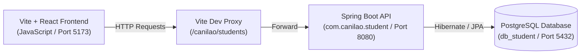

# Project Context & Continuation Guide: Student CRUD Application

This document preserves the complete architectural context, API contract, technology choices, and step-by-step roadmap for developing the Vite + React (JavaScript) frontend for the Student CRUD API.

---

## 1. System Architecture Overview



---

## 2. Backend Analysis (Existing Spring Boot Service)

- **Source Location**: `./student`
- **Framework**: Spring Boot 3.x (Java 21, Maven)
- **Database**: PostgreSQL (`jdbc:postgresql://localhost:5432/db_student`, user: `postgres`)
- **Base URI**: `/canilao/students`
- **Controller**: `StudentController.java` (`@Controller`, `@RequestMapping(path="/canilao/students")`)

### Data Model (`Student.java`)
| Field | Type | Description |
| :--- | :--- | :--- |
| `id` | `Integer` | Primary Key, Auto-generated |
| `firstname` | `String` | Student's first name |
| `lastname` | `String` | Student's last name |
| `course` | `String` | Degree program (e.g., BSCS, BSIT, BSIS) |
| `section` | `String` | Class section (e.g., 3A, 4B) |

### REST Endpoints
| Method | Endpoint | Request Body | Response Body | Status Codes |
| :--- | :--- | :--- | :--- | :--- |
| **GET** | `/canilao/students` | None | `Student[]` | `200 OK` |
| **GET** | `/canilao/students/{id}` | None | `Student` | `200 OK`, `404 Not Found` |
| **POST** | `/canilao/students` | JSON: `{ firstname, lastname, course, section }` | Created `Student` | `201 Created` |
| **PUT** | `/canilao/students/{id}` | JSON: `{ firstname, lastname, course, section }` | Updated `Student` | `200 OK`, `404 Not Found` |
| **DELETE** | `/canilao/students/{id}` | None | Plain Text Confirmation | `200 OK`, `404 Not Found` |

> **CORS Resolution Note**:
> The existing backend controller does not yet include `@CrossOrigin`. To ensure zero CORS friction:
> 1. In development: Configure Vite's dev server proxy in `vite.config.js` to route requests directly to `http://localhost:8080`.
> 2. In backend (optional/recommended): Add `@CrossOrigin(origins = "*")` to `StudentController.java`.

---

## 3. Frontend Architecture (Vite + React + JavaScript)

### Proposed Directory Layout (`./frontend`)
```
frontend/
├── package.json
├── vite.config.js               # Dev server with proxy to backend
├── index.html
├── src/
│   ├── main.jsx                 # React root mount
│   ├── App.jsx                  # Main layout, state coordination, notifications
│   ├── App.css                  # UI styling (modern, responsive clean theme)
│   ├── index.css                # Global styles, reset, fonts
│   ├── services/
│   │   └── studentService.js    # API abstraction (getAll, getById, create, update, delete)
│   ├── components/
│   │   ├── Navbar.jsx           # App brand header & actions
│   │   ├── StudentList.jsx      # Table/card list with search, filter, edit/delete actions
│   │   ├── StudentFormModal.jsx # Add/Edit modal form with validation
│   │   ├── DeleteConfirmModal.jsx # Safe delete confirmation dialogue
│   │   ├── ToastNotification.jsx  # Success/error feedback alerts
│   │   └── LoadingSpinner.jsx   # UI loading indicator
│   └── utils/
│       └── validation.js        # Form input validation helpers
```

### Key UI Features Planned
1. **Full CRUD Support**:
   - **Create**: Add new student modal form with field validations.
   - **Read**: Dynamic student table with quick search (filter by name/course/section) and refresh trigger.
   - **Update**: Edit button pre-fills modal with existing data, submitting a PUT request.
   - **Delete**: Delete button triggers confirmation modal before sending DELETE request.
2. **Resilient UX**:
   - Loading spinners during network calls.
   - Toast notifications for error messages and success confirmations.
   - Empty state UI when no students are registered.
3. **Responsive Design**:
   - Modern, high-contrast, clean layout adapted for mobile and desktop screens.

---

## 4. Phased Implementation Plan

- [ ] **Phase 1: Project Scaffolding & Proxy Setup**
  - Initialize Vite React project in `./frontend`.
  - Configure `vite.config.js` proxy pointing to `http://localhost:8080`.
- [ ] **Phase 2: Service Layer**
  - Implement `src/services/studentService.js` handling `fetch` / `axios` CRUD requests with clean error propagation.
- [ ] **Phase 3: Core UI Components**
  - Build `Navbar`, `StudentList`, `StudentFormModal`, and `DeleteConfirmModal`.
  - Add search and filtering capabilities.
- [ ] **Phase 4: State Management & Toast Notifications**
  - Wire up `App.jsx` state flow (list fetching, modal open/close, optimistic or refreshed UI updates).
  - Add success/error alerts.
- [ ] **Phase 5: Backend Alignment & CORS Support**
  - Verify Spring Boot runs smoothly and test end-to-end integration.

---

## 5. Guide: How to Resume Work on Another Computer

When cloning or pulling this repository to a new computer:

### Step 1: Clone / Copy the Repo
```bash
git clone <your-repo-url>
cd "STUDENT- CRUD"
```

### Step 2: Set Up Backend
1. Ensure Java 21+ and PostgreSQL are installed.
2. Create PostgreSQL database:
   ```sql
   CREATE DATABASE db_student;
   ```
3. Update `student/src/main/resources/application.properties` with your PostgreSQL username/password if different.
4. Run the backend:
   ```bash
   cd student
   ./mvnw spring-boot:run
   ```
   *(Backend will start on `http://localhost:8080`)*

### Step 3: Scaffolding / Running the Frontend
1. Navigate to the frontend directory:
   ```bash
   cd frontend
   npm install
   npm run dev
   ```
2. Open `http://localhost:5173` in your browser.
